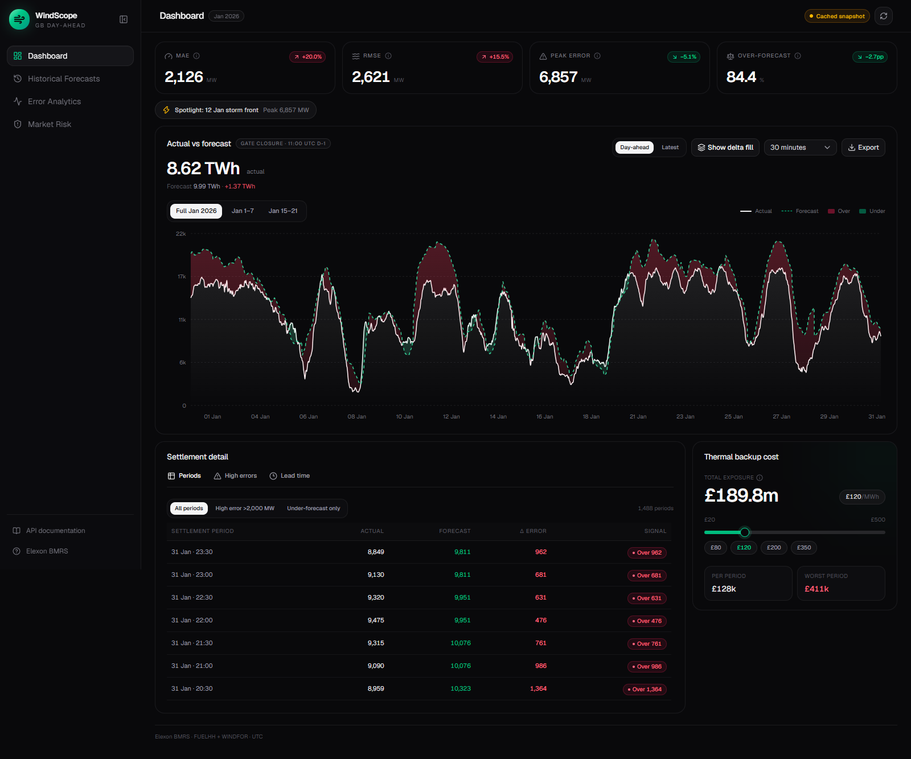
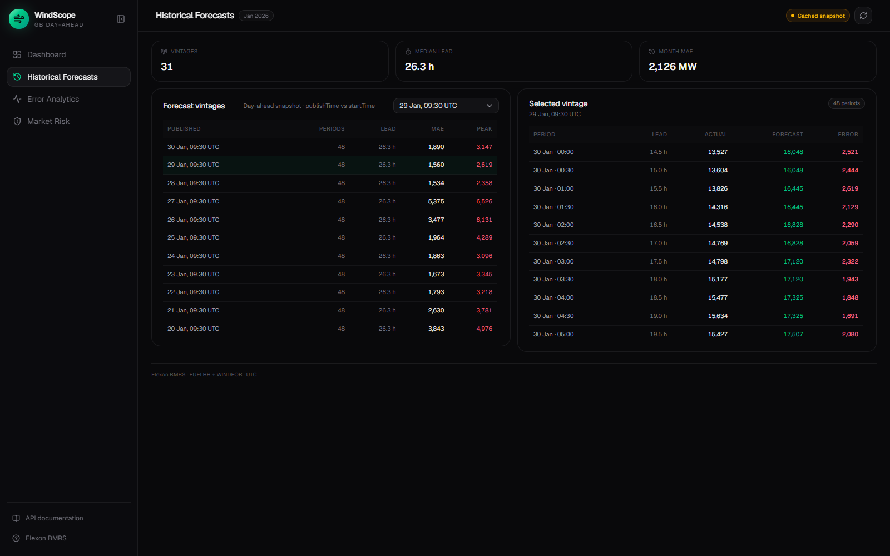
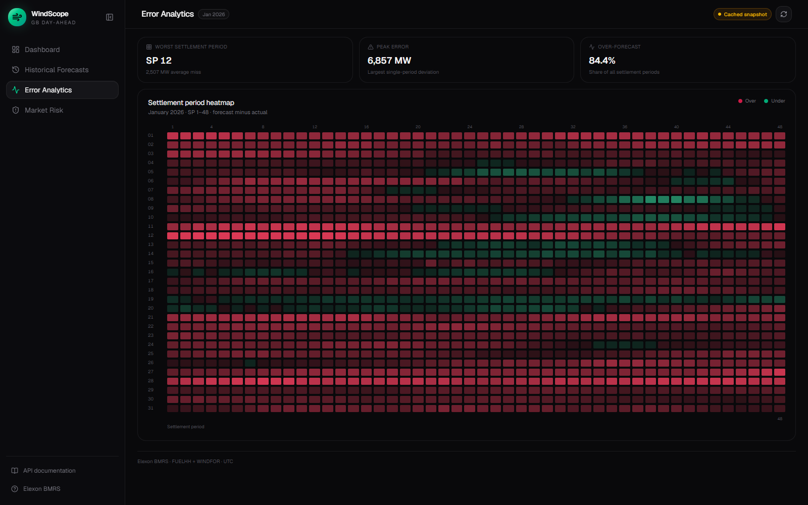
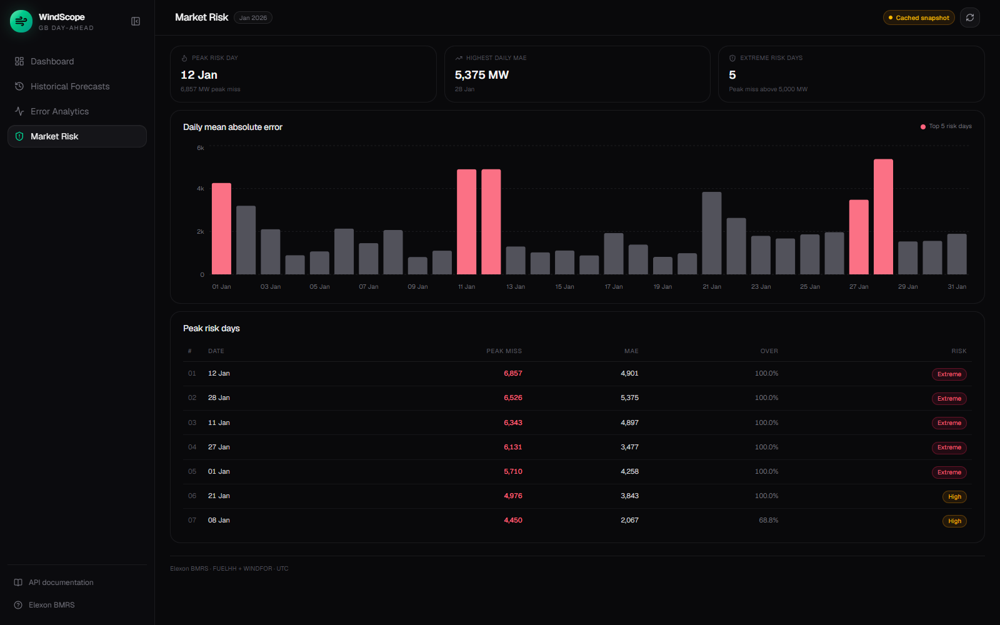
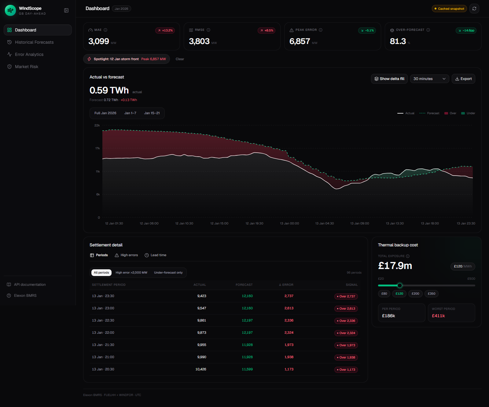

# WindScope — UK Wind Forecast Intelligence

Full-stack analytics portal for a UK energy utility's day-ahead power
procurement team. It compares **Elexon WINDFOR wind forecasts** with **actual
wind generation (FUELHH)** for **January 2026**, quantifies forecast error, and
translates that error into thermal-backup cost exposure.



> Status: **Live on Vercel** — dashboard and API are deployed and verified.
>
> - Frontend: <https://windscope-lksjd.vercel.app>
> - Backend API: <https://windscope-api-lksjd.vercel.app>
> - API docs: <https://windscope-api-lksjd.vercel.app/docs>
>
> The remaining manual step is recording the demo video and submitting the form.

## What the dashboard does

- **Actual vs forecast** chart across 30-minute settlement periods, with **Full
  Jan 2026**, **Jan 1–7** and **Jan 15–21** presets plus 30-minute, 1-hour and
  3-hour resolution controls.
- **Snapshot toggle** between the strict **Day-ahead** vintage (published before
  11:00 UTC on D-1) and the **Latest** published vintage. The chart, table and
  KPI values follow the selected snapshot; KPI deltas compare it with the other
  vintage.
- **Show delta fill toggle** that shades every miss red when forecast > actual and
  green when forecast < actual, so over/under-forecast volume is visible without
  reading the tooltip.
- **Storm event spotlight** that jumps to the 48-hour window around the largest
  error in the data. In the January 2026 snapshot the true peak is **6,857 MW at
  2026-01-12 01:00 UTC**, so the pill is generated from the API rather than
  hard-coded to a date.
- **KPI cards** for MAE, RMSE, peak wind imbalance and forecast bias ratio, with
  coloured deltas against the alternate forecast vintage for the same window.
- **Settlement Period Details**, **High Error Events Table** and **Publish Lead
  Time Analysis** tabs. The details table has instant **All periods**,
  **High error >2,000 MW** and **Under-forecast only** filters.
- **Analytical views** in the sidebar:
  - **Historical Forecasts** — filters the 31 gate-closure publication vintages
    and compares `publishTime` with `startTime` (median lead time and per-period
    detail).
  - **Error Analytics** — a 31-day × 48-settlement-period heatmap, with red for
    over-forecast and green for under-forecast.
  - **Market Risk** — ranks January days by peak absolute miss and daily MAE,
    with extreme/high risk bands and a top-risk-day table.
- **Thermal backup cost estimator** with a £/MWh slider that turns absolute MW
  error into financial exposure.
- **Provenance and failure handling**: live/cached/offline status, refresh,
  loading skeletons, retries and cached-empty states.
- **CSV / JSON export** of the aligned series from the chart toolbar. CSV columns
  are `startTime`, `settlementPeriod`, `actual_mw`, `forecast_mw`, `error_mw`,
  `bias_type` and `imbalance_cost_gbp` (30-minute energy at £120/MWh).

<p align="center">
  
  
  
</p>

<p align="center">
  
</p>


## Repository layout

```
wind-app/
├── backend/                          # FastAPI + pandas data engine
│   ├── main.py                       # ASGI entrypoint (CORS, router mounting)
│   ├── Dockerfile                    # Python 3.12 production image
│   ├── requirements.txt
│   ├── requirements-dev.txt          # pytest and friends
│   ├── pytest.ini
│   ├── .env.example
│   ├── app/
│   │   ├── api/
│   │   │   ├── router.py
│   │   │   └── v1/endpoints/         # health, generation_data, metrics
│   │   ├── core/config.py            # env settings, gate closure, cache path
│   │   ├── models/schemas.py         # Pydantic response contracts
│   │   └── services/
│   │       ├── elexon.py             # retrying BMRS client
│   │       ├── cache.py              # atomic JSON cache + fallback
│   │       ├── wind.py               # alignment pipeline
│   │       └── metrics.py            # MAE / RMSE / imbalance math
│   ├── data/cache_jan2026.json       # committed January 2026 snapshot
│   └── tests/                        # metric + alignment + fallback tests
├── frontend/                         # Next.js 16 (App Router) + TS + Tailwind
│   ├── Dockerfile                    # standalone production image
│   ├── src/app/                      # layout, page, theme tokens
│   ├── src/components/dashboard/     # chart, KPI cards, tables, estimator
│   ├── src/components/views/         # historical, error analytics, market risk
│   ├── src/components/ui/            # shadcn/Radix primitives
│   ├── src/hooks/                    # dashboard loading/refresh state
│   ├── src/lib/api.ts                # typed API client
│   ├── src/lib/format.ts             # MW/GBP/date/CSV formatting
│   ├── src/lib/ranges.ts             # date presets + resolution types
│   └── src/types/api.ts              # API contracts
├── docs/                             # dashboard and analytical-view screenshots
├── docker-compose.yml                # backend + frontend orchestration
├── .env.example
└── README.md
```

## Architecture

```
Next.js dashboard (browser)
        │  typed JSON over HTTP
        ▼
FastAPI + pandas transformation engine
        │  fetch / cache fallback
        ▼
Elexon BMRS (FUELHH actuals + WINDFOR forecasts)
```

The dashboard only talks to `/api/v1`. The browser reaches the backend at
`NEXT_PUBLIC_API_URL` (default `http://localhost:8000`). CORS is restricted to
the configured frontend origins.

## API contract

| Method | Path                         | Purpose                                                   |
| :----- | :--------------------------- | :-------------------------------------------------------- |
| GET    | `/api/v1/health`             | Liveness probe with service metadata                      |
| GET    | `/api/v1/generation-data`    | 30-minute aligned actual/forecast series                  |
| GET    | `/api/v1/metrics`            | MAE, RMSE, max error, net imbalance, over/under frequency |

Both data endpoints accept `start`, `end` (`YYYY-MM-DD`, inside January 2026)
and `snapshot` (`day_ahead` by default, or `latest`). `/metrics` also returns
`max_error_time`, the settlement period of the largest absolute error, which
drives the storm spotlight. Interactive docs: <https://windscope-api-lksjd.vercel.app/docs>
(local: <http://localhost:8000/docs>).

```jsonc
// GET /api/v1/generation-data?start=2026-01-05&end=2026-01-05
{
  "count": 48,
  "interval_minutes": 30,
  "start": "2026-01-05",
  "end": "2026-01-05",
  "snapshot": "day_ahead",
  "source": "cache",
  "cache_updated_at": "2026-10-28T08:55:42Z",
  "points": [
    {
      "startTime": "2026-01-05T00:00:00Z",
      "publishTime": "2026-01-04T09:30:00Z",
      "actual_mw": 10601.0,
      "forecast_mw": 11809.0,
      "error_mw": 1208.0
    }
  ]
}
```

## Data pipeline

1. **Actuals** — `GET /datasets/FUELHH/stream` with `settlementDateFrom`,
   `settlementDateTo` and `fuelType=WIND`. January 2026 yields 1,488 complete
   half-hour settlement periods.
2. **Forecasts** — `GET /datasets/WINDFOR/stream` with
   `publishDateTimeFrom` / `publishDateTimeTo`. The publish window starts two
   days before the month (so New Year's Day has a pre-gate vintage) and ends
   one day after, yielding ~18k vintage rows.
3. **Day-ahead selection** — for each settlement period, keep the latest
   forecast published **strictly before 11:00 UTC on D-1** (market gate
   closure). `snapshot=latest` instead selects the most recent publication for
   comparison.
4. **30-minute alignment** — WINDFOR is published **hourly**, so each hourly
   forecast is applied to the two settlement periods it covers (e.g. 13:00 and
   13:30 use the 13:00 value). Exact half-hourly matches take precedence if
   Elexon ever publishes them.
5. **Errors** — `error_mw = forecast_mw - actual_mw`. Positive values mean the
   utility over-forecast wind and may be exposed to imbalance penalties.

### Metric definitions

| Metric                    | Definition                                                     |
| :------------------------ | :------------------------------------------------------------- |
| `mae_mw`                  | mean of `abs(forecast - actual)`                               |
| `rmse_mw`                 | `sqrt(mean((forecast - actual)^2))`                            |
| `max_error_mw`            | largest absolute error in the window                           |
| `total_net_imbalance_mw`  | signed sum of `forecast - actual` (MW)                         |
| `over_forecast_pct`       | share of aligned periods with `error > 0`                      |
| `under_forecast_pct`      | share with `error < 0` (exact ties count in neither bucket)    |

Metrics are computed only on periods where both actual and forecast exist, so
`sample_size` always reflects real evidence. `max_error_time` is the `startTime`
of the period that produced `max_error_mw`.

**January 2026 day-ahead result:** 1,488 periods, MAE **2,126.12 MW**, RMSE
**2,620.80 MW**, max error **6,857 MW**, net imbalance **2,738,361 MW**, with
**84.41%** of periods over-forecast.

## Resilience & caching

- Dataset snapshot: `backend/data/cache_jan2026.json` (committed, ~1.7 MB) so a
  fresh clone serves data even if Elexon is down.
- Writes are atomic (`.tmp` + `os.replace`), versioned, and timestamped.
- If the cache is older than `CACHE_TTL_SECONDS` (default 24h) the API tries
  Elexon first; on timeout, HTTP 429/5xx or malformed payloads it silently
  serves the cache and logs a warning. Up to two attempts (configurable) with
  exponential backoff.
- A fetch with incomplete FUELHH or WINDFOR coverage is rejected, so a partial
  upstream response can never overwrite the good snapshot.
- Responses report `source` (`elexon` / `cache`) and `cache_updated_at`; the
  dashboard surfaces this in the top bar and sidebar.
- If neither source is available, endpoints return `503` with a clear message
  and the UI switches to an explicit offline state with retry.

## Local setup

### Option A — Docker Compose (recommended)

```bash
cp .env.example .env
docker compose up --build
```

- Dashboard: <http://localhost:3000>
- API docs: <http://localhost:8000/docs>
- Health: <http://localhost:8000/api/v1/health>

`NEXT_PUBLIC_API_URL` is **inlined at frontend build time**. If you change it
(e.g. to point at a cloud backend), rebuild the frontend image.

### Option B — manual

**Backend**

```bash
cd backend
python -m venv .venv
# Windows: .venv\Scripts\activate
# macOS/Linux: source .venv/bin/activate
pip install -r requirements.txt
cp .env.example .env
uvicorn main:app --reload --port 8000
```

Tests:

```bash
pip install -r requirements-dev.txt
pytest
```

**Frontend**

```bash
cd frontend
npm install
# .env.local
echo "NEXT_PUBLIC_API_URL=http://localhost:8000" > .env.local
npm run dev
```

Dashboard: <http://localhost:3000>. If port 3000 is busy Next will choose 3001;
the backend's default CORS list already allows both.

Quality checks:

```bash
npm run lint
npm run build
```

## Environment variables

| Variable                      | Default                                                          | Purpose                              |
| :---------------------------- | :--------------------------------------------------------------- | :----------------------------------- |
| `CORS_ORIGINS`                | `http://localhost:3000,http://127.0.0.1:3000,http://localhost:3001,http://127.0.0.1:3001` | Comma-separated allowed origins |
| `ELEXON_BASE_URL`             | `https://data.elexon.co.uk/bmrs/api/v1`                          | BMRS API base                        |
| `DATA_YEAR` / `DATA_MONTH`    | `2026` / `1`                                                     | Dataset scope                        |
| `GATE_CLOSURE_HOUR_UTC`       | `11`                                                             | Day-ahead cut-off on D-1             |
| `CACHE_FILE`                  | `backend/data/cache_jan2026.json`                                | Cache location                       |
| `CACHE_TTL_SECONDS`           | `86400`                                                          | Freshness window before refresh      |
| `ELEXON_TIMEOUT_SECONDS`      | `30`                                                             | Per-request timeout                  |
| `ELEXON_MAX_RETRIES`          | `2`                                                              | Attempts before falling back         |
| `NEXT_PUBLIC_API_URL`         | `http://localhost:8000`                                          | Browser-visible backend base URL     |

## Deployment

The app is deployed as two independent Vercel projects:

| Project | Vercel project | Production URL |
| :--- | :--- | :--- |
| Frontend | `windscope-lksjd` | <https://windscope-lksjd.vercel.app> |
| Backend | `windscope-api-lksjd` | <https://windscope-api-lksjd.vercel.app> |

Deployment protection is disabled so the URLs are publicly accessible in an
incognito window.

Production environment variables:

```text
# windscope-lksjd (frontend)
NEXT_PUBLIC_API_URL=https://windscope-api-lksjd.vercel.app

# windscope-api-lksjd (backend)
ENVIRONMENT=production
CORS_ORIGINS=https://windscope-lksjd.vercel.app,https://windscope-lksjd-yazudangol-gmailcoms-projects.vercel.app,http://localhost:3001,http://127.0.0.1:3001
```

`NEXT_PUBLIC_API_URL` is inlined at build time, so changing the backend URL
requires a frontend rebuild.

### Redeploying

Vercel detects the FastAPI `app` in `backend/main.py`; `backend/vercel.json`
raises the function timeout to 60 seconds. From each project directory:

```bash
# Backend
cd backend
npx vercel link --yes --project windscope-api-lksjd --scope yazudangol-gmailcoms-projects
npx vercel deploy --prod --yes --scope yazudangol-gmailcoms-projects

# Frontend
cd ../frontend
npx vercel link --yes --project windscope-lksjd --scope yazudangol-gmailcoms-projects
npx vercel deploy --prod --yes --scope yazudangol-gmailcoms-projects
```

The projects are intentionally deployed from their subdirectories, so the
Vercel project **Root Directory** setting is left empty. The checked-in
`Dockerfile` and `docker-compose.yml` remain available for self-hosting.

## AI tool disclosure

This project was built with AI assistance. Tools used:

- **OpenCode** — agentic coding environment used for implementation,
  refactoring and test iteration.
- **DeepSeek V4.1 Flash** — the model powering the OpenCode agent.
- **shadcn/ui CLI** — scaffolded the Radix-based UI primitives and theme
  wiring.
- **Vercel MCP** — created both projects, set environment variables, checked
  deployment status/build logs/runtime errors, and verified the production
  request logs. Vercel CLI was used for the local source upload because the
  GitHub repository is not connected to Vercel's Git integration.

No ChatGPT, Claude, GitHub Copilot or other AI coding tools were used. All
AI-generated code was reviewed and verified with the backend test suite
(13 passing tests), `npm run lint`, `npm run build`, and browser-level
Playwright checks covering live data, range changes, tabs, the storm spotlight,
delta shading, settlement filters, analytical views, CSV download, refresh,
mobile layout and offline failure states. The production deployment was also
checked for `200` responses, CORS, build logs and runtime errors.
